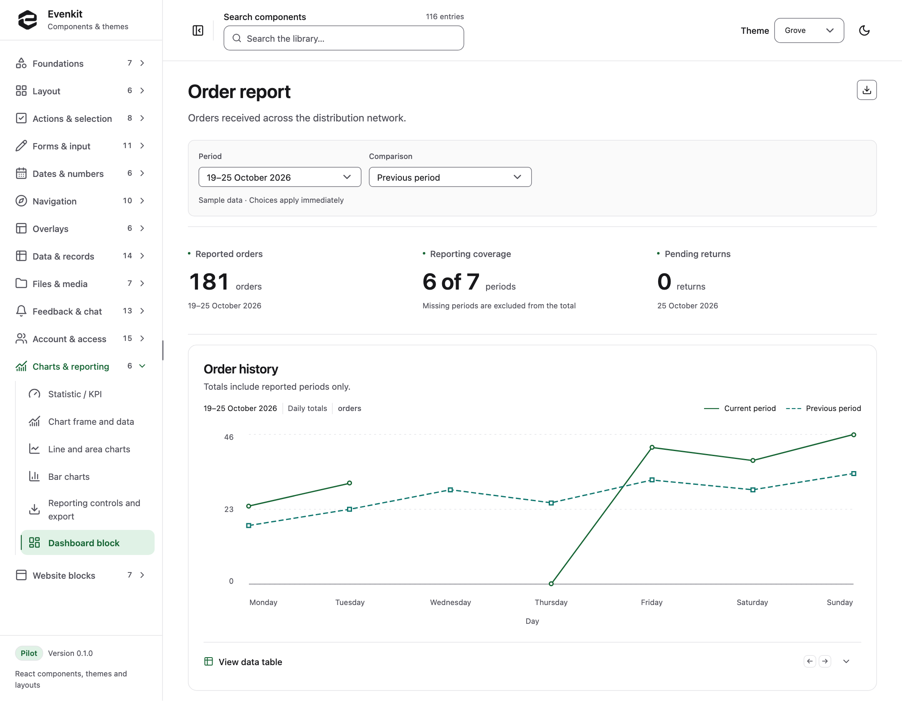

<div align="center">

# Evenkit

### React components for product interfaces.

Design tokens, application UI, editable page blocks, and AI chat.<br />
One visual system, with light and dark appearances throughout.

[**Explore the catalog ↗**](https://evenkit.dev) · [Quick start](#quick-start) · [Documentation](#documentation)

**116** catalog entries &nbsp; / &nbsp; **8** themes &nbsp; / &nbsp; **23** editable blocks

</div>

<br />

<a href="https://evenkit.dev/#dashboard">
  <picture>
    <source media="(prefers-color-scheme: dark)" srcset="docs/images/catalog-dark.png" />
    <source media="(prefers-color-scheme: light)" srcset="docs/images/catalog-light.png" />
    
  </picture>
</a>

<p align="center"><sub>The live dashboard example, built with Evenkit components. Click the screenshot to try it.</sub></p>

## What's in the kit

Evenkit brings the controls and compositions of a product interface into one library. Browse working examples, switch themes, and copy the usage code into your project.

| Area | Includes |
| :--- | :--- |
| **Foundations** | Typed design tokens, eight palettes, light and dark modes, and 215 animated icons |
| **Application UI** | Buttons, forms, date inputs, selection controls, navigation, dialogs, and feedback |
| **Data and workflows** | Tables, filters, record pages, uploads, document libraries, and team administration |
| **Reporting and chat** | Charts, dashboards, embedded and floating chat, Markdown messages, sources, and attachments |
| **Editable blocks** | Application pages, account settings, onboarding, and website sections |

Components include keyboard interaction, focus recovery, loading and error states, and reduced-motion behavior. Your application owns data, requests, routing, and product rules.

The UI uses React 19, TypeScript, and ordinary CSS, with Radix and Base UI primitives. Styles use `pk-` classes and `--pk-` variables. The UI package requires neither Tailwind nor an application framework.

## Quick start

Requires **Node.js 22.12+** and npm.

```sh
git clone https://github.com/salexandr0s/evenkit.git
cd evenkit
npm ci
npm run dev
```

Open [localhost:5173](http://localhost:5173) to browse the catalog. Search by component name, try a state or interaction, then copy its example. All preview data is fictional and local.

The dev command builds the packages first. After editing package source, run `npm run build:packages` to refresh the artifacts used by the catalog.

### Use the components

The packages are currently local and unpublished. [Build and install the package tarballs](docs/component-guide.md#use-in-another-project), then import the token stylesheet before the UI stylesheet:

```tsx
import "@evenkit/tokens/css";
import "@evenkit/ui/css";
import { Button, TextField } from "@evenkit/ui";

export function ProjectForm() {
  return (
    <form>
      <TextField label="Project name" name="projectName" required />
      <Button type="submit">Create project</Button>
    </form>
  );
}
```

Your application supplies the submit handler and storage. Fields associate labels, hints, and errors with their controls; loading buttons keep their names and dimensions while work is pending.

### Choose a theme

Neutral · Grove · Graphite · Linen · Ocean · Dusk · Clay · Rose

Set the theme and appearance on the document root:

```html
<html lang="en" data-kit-theme="grove" data-kit-mode="dark">
```

Omit `data-kit-mode` to follow the system appearance. Themes apply to controls, layouts, charts, and overlays. [Compare the palettes in the catalog](https://evenkit.dev/#themes) or [create a custom brand](packages/tokens/README.md).

### Try the admin starter

The repository includes a Next.js application with fictional workspace data, editable records, and request recovery examples.

```sh
npm run dev:admin
```

Open [localhost:5396/dashboard](http://localhost:5396/dashboard). The demo runs without credentials. An optional Supabase authentication adapter lives in its own package. See the [admin starter guide](docs/admin-starter.md) for setup and customization.

## Packages

| Package | Purpose |
| :--- | :--- |
| [`@evenkit/tokens`](packages/tokens) | Typed scales, semantic colors, theme validation, and generated CSS/JSON |
| [`@evenkit/ui`](packages/ui) | Reusable React components, icons, layouts, tables, and chat |
| [`@evenkit/auth-next`](packages/auth-next) | Optional Supabase authentication adapter for Next.js |
| [`@evenkit/catalog`](apps/catalog) | Interactive component reference, built with Vite |
| [`@evenkit/admin-starter`](apps/admin-starter) | Runnable Next.js example application |

[Editable blocks](registry/blocks) live alongside the packages. Copy their source into your application and connect your own callbacks and services; see the [block registry guide](docs/block-registry.md).

## Documentation

| Start here | Guides |
| :--- | :--- |
| **Component integration** | [Package installation and API examples](docs/component-guide.md) · [Compatibility](docs/compatibility.md) |
| **Design and interaction** | [Tokens and themes](packages/tokens/README.md) · [Icons](docs/icons.md) · [Forms](docs/form-controls.md) · [Navigation](docs/navigation.md) · [Overlays](docs/overlays.md) |
| **Data and files** | [Remote tables](docs/remote-tables.md) · [Records and settings](docs/records-settings.md) · [Uploads](docs/uploads.md) · [Document libraries](docs/document-library.md) |
| **Compositions** | [Chat](docs/chat.md) · [Rich chat](docs/rich-chat.md) · [Reporting](docs/reporting.md) · [Team administration](docs/team-administration.md) · [Website blocks](docs/website-blocks.md) |
| **Application setup** | [Admin starter](docs/admin-starter.md) · [Authentication adapter](docs/auth-adapter.md) · [Block registry](docs/block-registry.md) |

### For coding agents

Use [llms.txt](https://evenkit.dev/llms.txt) for setup instructions and an index of every catalog entry and block. [llms-full.txt](https://evenkit.dev/llms-full.txt) includes the guide and all usage examples. The [authored guide](apps/catalog/llms/guide.md) is checked into this repository.

## Development

| Command | Runs |
| :--- | :--- |
| `npm run build` | Production builds for the packages, catalog, and admin starter |
| `npm run typecheck` | TypeScript checks across the workspace |
| `npm run lint` | ESLint |
| `npm test` | Unit and integration tests |
| `npm run test:browser` | Catalog journeys in Chromium |
| `npm run test:admin` | Admin journeys in Chromium, Firefox, and WebKit |
| `npm run verify:examples` | Compilation of copied catalog examples |
| `npm run verify:packages` | Packed-package checks in independent Vite and Next.js consumers |

Install browser dependencies with `npx playwright install chromium firefox webkit`. Run `npm run verify` for the combined build, type, lint, unit, registry, and browser checks.

## Status and licensing

Evenkit **0.1.0** is a pilot for evaluation. Packages are local and unpublished; the original Evenkit code is currently `UNLICENSED`. Third-party dependencies retain their own licenses. Source and attribution details are recorded in the [UI provenance](packages/ui/PROVENANCE.md) and [token provenance](packages/tokens/PROVENANCE.md).
